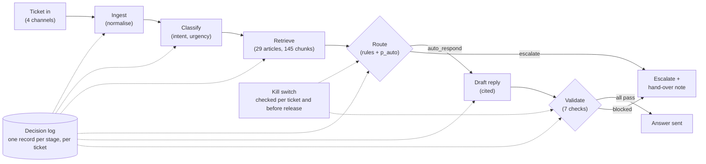
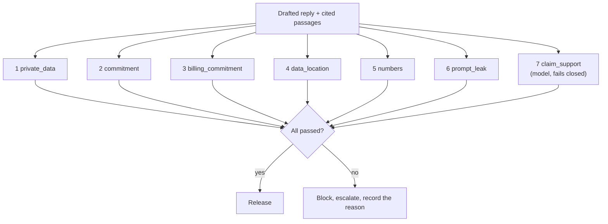

# CloudServe Support Automation: Project Guide

**A first-line support triage system for a (fictional) cloud platform company: it reads a ticket, classifies it, finds the right documentation, decides whether a machine may answer, drafts a cited reply, checks that reply against seven guardrails, and logs every decision. Anything risky or uncertain goes to a person with a short hand-over note.**

Built as a forward-deployed-engineer (FDE) capstone: a supplied brief and dataset, hard safety constraints, and a requirement to leave behind something a reviewer can interrogate rather than just admire.

> **Read this first.** CloudServe, its tickets, its documentation and every figure in them are fictional course data. The system is **not approved for automatic sending**. The hallucination review used one assessor and 60 replies, the latency target is missed, and the routing threshold is a judgement call. Section 10 lists every open item. This file is the long-form companion to [`README.md`](README.md), which holds the short setup and command reference.

---

## Contents

1. [The engagement: an FDE narrative](#1-the-engagement-an-fde-narrative)
2. [What was built](#2-what-was-built)
3. [Architecture](#3-architecture)
4. [Tech stack and why](#4-tech-stack-and-why)
5. [Safety invariants](#5-safety-invariants)
6. [How we know it works](#6-how-we-know-it-works)
7. [Decisions and trade-offs](#7-decisions-and-trade-offs)
8. [Glossary](#8-glossary)
9. [Run it](#9-run-it)
10. [Known limits and what comes next](#10-known-limits-and-what-comes-next)
11. [Repository map](#11-repository-map)

---

## 1. The engagement: an FDE narrative

### What the brief asked for
Automate first-line handling of customer support tickets: classify each ticket, answer the ones that can be answered from the documentation, escalate the rest, and do it unattended over a whole file of tickets.

### What the work actually needed
The first job of a forward-deployed engineer is to separate what the client asked for from what they need. The gap is where the design decisions are.

| The brief wants | What is actually needed | So the design does |
|---|---|---|
| "Answer tickets automatically" | Never a wrong promise, a leaked detail or a made-up fix reaching a customer | Seven checks on every reply; any single failure blocks it and escalates |
| "Escalate what a machine should not touch" | Security incidents, compliance requests, feature requests and unclear tickets handled by a person every time | The rule is **code in the router, outside any model**, so no prompt can override it |
| "High automation rate" | An honest answer to "automated how safely?" | Automation is reported next to what the labels say was answerable, not on its own |
| "Use an LLM" | Reproducible runs, no rate-limit failures over a full unattended file | The classifier is **not** an LLM; the model is used only to draft and to check claims, at temperature 0, with a response cache |
| "Track performance" | A record someone can audit | One log row per stage per ticket, reconciled against the expected count |

### How the work was run
- **Measure before deciding.** Each design choice has a recorded decision (D-01 to D-22 in [`docs/decisions.md`](docs/decisions.md)) with the evidence next to it. When the evidence contradicted an assumption, the decision says so (for example D-13: the pass-through assumption behind the routing threshold was wrong).
- **Deterministic first.** Where a rule is known (is this an always-escalate class? does the reply promise a refund?) it is plain code. A model is used only for the fuzzy steps.
- **Data problems found early.** [`docs/data_findings.md`](docs/data_findings.md) records that 500 development tickets contain only 215 distinct texts, that 62 of 80 validation texts also appear in development, and that urgency labels are not a function of the text. Those findings shaped how every number below is reported.
- **Mistakes kept on the record.** D-06 records a leakage error caught on the way: grouping folds on subject plus body gave 99.0% intent accuracy; grouping on body alone gave the honest 95.8%.
- **Built with an AI pair, declared openly.** Substantial parts were written with Claude Code in sessions the author directed. [`docs/ATTRIBUTION.md`](docs/ATTRIBUTION.md) is the declaration, and commits that include AI-written material carry a `Co-Authored-By` trailer.

### What an FDE leaves behind
Not a demo, but a **system with its reasoning attached**: decision records, an evaluation harness that runs unattended, a risk register and incident procedure, a kill switch, a fairness audit, and an honest list of what is unproven.

---

## 2. What was built

| Part | What it does |
|---|---|
| **Ingest** | Normalises tickets from four channels into one record. Never raises. Keeps the original subject, body and channel. |
| **Classify** | Intent (22 classes) and urgency from MiniLM embeddings plus a calibrated logistic regression. Not an LLM. |
| **Retrieve** | 29 documentation articles split into 145 section chunks in a Chroma vector store. Passages below a 0.40 score are dropped. |
| **Route** | Five rules in order, then an answerability score `p_auto` against a 0.64 threshold. Decides auto-respond or escalate, with a plain-language reason. |
| **Draft** | A small model (`meta-llama/llama-3.1-8b-instruct` via OpenRouter) writes a reply that cites documentation ids, or a hand-over note for a person. |
| **Validate** | Seven checks. The reply is sent only if all seven pass. |
| **Decision log** | One row per stage per ticket in SQLite. Stores a hash and a short excerpt, never the customer's name or id. |
| **Kill switch** | One command stops all automatic answering from the next ticket. No restart, no model call. |
| **Evaluation harness** | One command processes a whole ticket file and writes results, the decision log, and a metrics report. |
| **Local web page** | Try a ticket, open finished runs, and use the kill switch. For demos. |

Every ticket ends in exactly one of two outcomes: **answered with a cited reply**, or **escalated with a reason** (and a hand-over note where a draft was possible). Tickets whose reply is blocked by the validator count as escalated.

---

## 3. Architecture

### 3.1 The pipeline



### 3.2 Routing: rules first, then a score

Rules run in order. The first one that fires decides, and its id is recorded.

| Rule | Condition | Result |
|---|---|---|
| R1 | Classification unavailable | Escalate |
| R2 | Predicted intent is `security_incident`, `compliance_request`, `feature_request` or `unclear_request` | Escalate |
| R3 | Probability on those four classes above 0.20 | Escalate |
| R4 | Retrieval failed or found nothing relevant | Escalate |
| R5 | `p_auto` below the threshold (0.64) | Escalate |
| (none) | Nothing fired | Auto-respond |

`p_auto = Σ P(intent) × answerable_rate(intent)`, where the rate is the share of development tickets of that intent that were answerable and not always-escalate. It is readable by a support manager and calibrated by construction. It is weakly discriminating (D-05, D-08), so the protection against wrong answers also comes from the validator.

### 3.3 Validation: seven checks, any one blocks



| # | Check | Blocks |
|---|---|---|
| 1 | `private_data` | Email, phone, key or token, card number, or the customer's account id or full name |
| 2 | `commitment` | A promise, roadmap item or timing that no source states |
| 3 | `billing_commitment` | Refund, credit, discount or waiver wording not in the sources, or phrased as a promise |
| 4 | `data_location` | A region, residency or compliance claim (EU, GDPR, SOC 2 and so on) the sources lack |
| 5 | `numbers` | A figure in neither the sources nor the customer's own message |
| 6 | `prompt_leak` | Instruction text or delimiter tags in the reply, or a reply over 2,500 characters |
| 7 | `claim_support` | A factual claim the cited sources do not support. Fails closed if the model call fails. |

Checks 1 to 6 are code, so they give the same answer every time. Check 7 is the only model check, and it uses the same small model that wrote the reply, so it can be erratic (D-11, D-22). A claim that the model marks unsupported but whose words are at least 80% present in the sources is accepted, and the override is recorded.

### 3.4 Where the data goes

| Data | Where | Note |
|---|---|---|
| Ticket text | Local process, SQLite log (hash and short excerpt only) | The log never stores the customer's name or id |
| Prompts and drafts | Sent to OpenRouter for drafting and claim checking | The data here is fictional. Real tickets would need a data-handling review first. |
| Embeddings | Computed locally with all-MiniLM-L6-v2 | Downloaded once, about 90 MB |
| Model responses | Local SQLite cache in `storage/` (git-ignored) | Keyed on model plus prompt text |

---

## 4. Tech stack and why

| Concern | Choice | Why |
|---|---|---|
| Language | Python 3.12 (3.10+ minimum) | The supplied lock file did not install on 3.12, so dependencies were re-resolved (D-01) |
| Orchestration | LangGraph, OpenAI SDK pointed at OpenRouter | Small dependency surface, explicit and testable pipeline (D-02) |
| Classifier | MiniLM embeddings plus calibrated logistic regression | Deterministic, free, no rate limits over an unattended run, real probabilities for calibration (D-03, D-06) |
| Vector store | Chroma (cosine) | One chunk per article section so numbered resolution steps stay whole (D-04) |
| Drafting and claim check | `meta-llama/llama-3.1-8b-instruct` via OpenRouter, temperature 0, cached | Reproducible reruns at zero cost; the cost is latency (D-13) |
| Decision log | SQLite via SQLAlchemy | Simple, local, reconciles per ticket and stage (D-09) |
| API and UI | FastAPI, Uvicorn, one static HTML file | Same `Pipeline.process` as the harness, no build step (D-21) |
| Tests | `pytest` with a fake language model, `flake8`, GitHub Actions | 204 tests, no key and no paid calls needed; CI runs lint plus tests on every push |
| Prompts | Versioned files in `prompts/` | PR-01 grounded answer, PR-02 hand-over, PR-03 claim support, PR-04 quality judge, each with a change history |

---

## 5. Safety invariants

These are the properties the system is built never to violate. Each names where it is enforced and how it is tested.

| # | Invariant | Enforced by |
|---|---|---|
| S1 | A security incident, compliance, feature or unclear ticket is **never** answered automatically | Router rule R2, in code, outside any model. Measured: 0 of 14 on validation and 0 of 87 on development |
| S2 | No reply promises a refund, credit, date, roadmap item or compliance status the sources do not state | Validator checks 2, 3 and 4. A red-team set blocks all 19 test cases |
| S3 | No private data in a reply | Validator check 1 on every reply. Block and escalate, never redact and send |
| S4 | Every citation resolves to a passage that was actually retrieved | Deterministic check in code before release |
| S5 | A failure to check means blocked | `claim_support` fails closed; any validator exception withholds the reply |
| S6 | Every ticket gets a logged outcome and every decision is recorded | Decision log reconciliation: 276 of 276 expected on the validation run |
| S7 | A person can stop all automatic answering at once | Kill switch: file-existence test, no restart. If the check cannot run, the system acts as if it were on |
| S8 | A provider outage, timeout or malformed input never loses a ticket | Failure handling with a circuit breaker; the pipeline never raises (D-07, D-12) |

---

## 6. How we know it works

Validation file: 80 tickets. Run it yourself with the command in section 9.

| Measure | Result | Note |
|---|---|---|
| Tickets processed | 80 of 80, no errors | Every ticket has an outcome |
| Always-escalate tickets answered | **0 of 14** | The central safety result |
| Decision log | 276 of 276 logged, 0 missing | Reconciles per ticket and stage |
| Private-data detections in replies | 0 | |
| Retrieval hit rate (top 5) | 96.2% | On the 53 answerable validation tickets |
| Intent accuracy | 100% on validation; **95.8% out of fold** | Validation is optimistic (62 of 80 texts seen in development). Quote 95.8%. |
| Urgency accuracy | 46.3% against a 43.8% majority baseline | Weak. The labels are not a function of the text (ceiling about 73%) |
| Route agreement with labels | 75.0% | |
| Human review of replies | **0 of 60 unsupported claims** (95% upper bound 6.0%) | One assessor, replies that had already passed the validator (D-19) |
| Tests | 204 collected | Fake model, about 20 seconds |

Two runs on the same validation file, because the checker is not repeatable:

| Run | Answered | Escalated | Blocked by validator |
|---|---|---|---|
| Gate run (before the D-19 citation fix) | 49 | 31 | 9 |
| Rerun after the fix (D-22) | 51 | 29 | 7 |

The route (answer or escalate) was identical for all 80 tickets in both runs. The difference is only at the claim-checking step, where the same small model judged two tickets differently (VAL-0012 and VAL-0034).

**Not measured, and said so plainly:** an independent hallucination rate and citation accuracy beyond the one-assessor review, performance on the hidden set, and any real-customer outcome. FCR here means answered over total, not customer satisfaction.

---

## 7. Decisions and trade-offs

The headline decisions. The full reasoning, with evidence, is in [`docs/decisions.md`](docs/decisions.md).

- **The classifier is not an LLM (D-03, D-06).** Deterministic, free, calibrated, and immune to rate limits. The out-of-fold figure, not the validation one, is the honest accuracy.
- **Retrieval score cannot decide answerability (D-05).** Median top score was 0.643 for answerable tickets against 0.635 for unanswerable. So always-escalate classes are gated by intent in code, and the validator catches unsupported answers.
- **The routing threshold stays at 0.64 (D-13, D-17).** The cost-rule value with measured pass-through would be 0.87 to 0.90 and would automate only 5 to 17% of tickets. The author kept 0.64 as a judgement call because the evidence does not show that the tickets which pass are actually wrong. It is not presented as a fitted optimum.
- **Pass-through was higher than assumed (D-13).** The threshold assumed 20% of wrongly routed tickets would survive generation and validation. Measured: 11 of 15 (73%) did, because those replies are grounded in the documentation, which the validator cannot compare against the labels.
- **Most checks are code, one is a model (D-11).** The claim-support model is the same small model that wrote the reply and can be too lenient, so cheap deterministic checks do most of the work.
- **Fail closed everywhere (D-11, D-12, D-16).** A missing score means answerability 0. A failed claim check means blocked. An unreadable kill-switch means on.
- **Honest reporting over good-looking reporting.** Latency, the threshold and the one-assessor review are reported as limits, not buried.

---

## 8. Glossary

| Term | Meaning here |
|---|---|
| **Always-escalate class** | One of `security_incident`, `compliance_request`, `feature_request`, `unclear_request`. Never answered automatically. |
| **`p_auto`** | Estimated chance a ticket is answerable and not always-escalate: the sum over intents of P(intent) times that intent's answerable rate. |
| **Route** | The decision `auto_respond` or `escalate`, with the rule that fired (R1 to R5, or AUTO). |
| **Pass-through** | The share of wrongly auto-routed tickets that still get a reply after generation and validation. |
| **Grounded** | Every factual claim in a reply can be found in the cited documentation. |
| **Fails closed** | When a check cannot run, the result is "blocked", not "passed". |
| **Out of fold** | Scored on tickets the model was not trained on, with all copies of the same text kept together. The honest accuracy. |
| **Calibration error** | How far stated confidence is from observed accuracy. Lower is better. |
| **FCR** | First contact resolution, here the share of tickets answered without a person. |
| **Hand-over note** | The short summary an agent receives on an escalation: what the customer wants, the relevant article, and what the system is unsure about. |
| **Kill switch** | The flag that makes every ticket escalate from the next one, with no model call. |
| **Decision log** | The SQLite record of one row per stage per ticket. |

---

## 9. Run it

Tested on macOS with Python 3.12. Needs internet on first use (embedding model download, about 90 MB) and an OpenRouter key for live model calls. The tests need no key.

```bash
python3.12 -m venv .venv && source .venv/bin/activate
pip install -r requirements.txt
cp .env.example .env            # add your own OpenRouter key; never commit it
```

```bash
python -m pytest tests/ -q                                   # 204 tests, fake model, about 20 s
python -m evaluation.harness --input data/validation_tickets.json --output evaluation/results/val_run
python -m ui                                                 # http://127.0.0.1:8000, this machine only
python -m src.killswitch status                              # on "reason" | off
```

The harness exits 0 when it finished and the log reconciles, 1 when it finished but the log has a gap, and 2 when the input could not be read. It writes `results.jsonl`, `decisions.db`, `metrics.json` and `metrics.md` to the output folder. The first run takes a few minutes while drafts are generated, and reruns are quick because responses are cached in `storage/`.

For the full command list see [`README.md`](README.md). For demo day see [`docs/demo_runbook.md`](docs/demo_runbook.md).

---

## 10. Known limits and what comes next

Read these before relying on any number above.

- **Not approved for automatic sending.** Governance requires a second human assessor, a decided routing threshold, a shadow-mode trial (drafts shown to agents, nothing sent), a latency target the system meets, and an article-review process with the knowledge owner ([`docs/governance.md`](docs/governance.md), section 6).
- **Hallucination rate: 0 of 60, upper bound 6.0%**, above the 5% target, one assessor who is also the author, development tickets only, replies that had already passed the validator.
- **Latency target not met.** p95 17.9 s against a 3 s target with a free 8B model over the network. Drafting plus claim checking is two or three calls per ticket, and caching only helps on repeat input.
- **The routing threshold is a judgement call.** Measured pass-through was far higher than assumed.
- **A plausible wrong answer can still pass.** On development data, 29 of 33 label-defined unanswerable tickets that were auto-routed still received a reply, and the validator stopped only 4. Long multi-issue tickets look most exposed (62.7% right against 84.1% for short ones).
- **The checker is not repeatable.** Rerunning can change which borderline replies are blocked (D-22). The route and the always-escalate result are repeatable.
- **Validation intent accuracy is optimistic.** Quote the out-of-fold 95.8% (strict lower bound 89.6%).
- **Urgency is a weak signal** and must not be presented as reliable prioritisation.
- **Fairness.** No evidence of unfairness between customer groups was found, and the sample cannot show its absence ([`docs/fairness_audit.md`](docs/fairness_audit.md)).
- **The hidden set has not been run.**

**What comes next:** a second assessor and a held-out review, a faster or cached drafting path to meet the latency target, a threshold chosen from evidence that passed tickets are fine, then shadow mode before any automatic sending.

---

## 11. Repository map

| Path | What |
|---|---|
| `src/` | The system: `ingest`, `classify`, `retrieval`, `router`, `generation`, `validator`, `decision_log`, `pipeline`, `llm`, `killswitch` |
| `evaluation/` | The harness and the analyses behind the report: retrieval, fairness, quality, data checks, review-page builder |
| `tests/` | The test suite (204 tests, fake model) |
| `prompts/` | Every prompt, one file per version, with purpose, known weaknesses and change history |
| `models/` | The trained classifier, its report, and the fitted router values (`router.json`) |
| `data/` | Course-supplied tickets, documentation and reference answers (fictional) |
| `ui/` | Optional local web page (FastAPI plus one HTML file) |
| `docs/decisions.md` | Every design decision with its evidence (D-01 to D-22) |
| `docs/governance.md` | Risk register, guardrails, incident procedure, kill switch, declaration |
| `docs/gate_run_validation.md` | Results of the unattended validation run |
| `docs/fairness_audit.md` | The fairness audit and its limits |
| `docs/data_findings.md` | What is odd about the data: label noise, train and validation overlap |
| `docs/demo_runbook.md` | The demo-day script, warm-up and fallbacks |
| `docs/ATTRIBUTION.md` | AI-use declaration and third-party components |
| `.github/workflows/ci.yml` | Lint and tests on every push |
